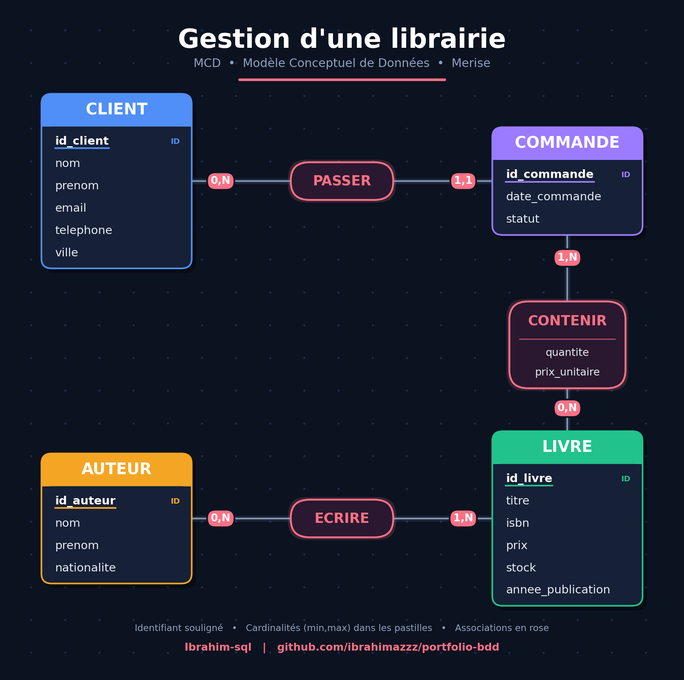

<h1 align="center">🗄️ Ibrahim | Bases de données & automatisation</h1>

  <b>Du cahier des charges à la base de données fonctionnelle</b> 
  MCD • MLD • SQL • Python

---

## 👋 À propos
Je suis étudiant en informatique, spécialisé dans la **modélisation et la création de bases de données** (méthode Merise). Je transforme vos besoins (texte, schéma, fichier Excel) en une base de données propre, structurée et prête à l'emploi.

## 🛠️ Ce que je propose

| Service | Ce que vous recevez |
|---|---|
| **Modélisation MCD / MLD** | Schémas clairs à partir de votre cahier des charges |
| **Script SQL** | Tables, clés, contraintes, données d'exemple |
| **Requêtes SQL** | Jointures, regroupements, statistiques |
| **Import de données (Python)** | Excel / CSV / texte → base de données |
| **Correction de bases existantes** | Analyse des erreurs et amélioration |

## 📁 Projets

| Projet | Description | Compétences |
|---|---|---|
| [📚 Librairie](./librairie) | Clients, livres, auteurs, commandes | Associations 1-N et N-N, jointures, agrégats |
| 🚗 Location de voitures | *(à venir)* | |
| 🐍 Import CSV → base de données | *(à venir)* | Python, SQL |

## ⚙️ Comment je travaille
1. **Vous m'envoyez** votre besoin (texte, schéma, exemple de données).
2. **Je vous propose** le MCD pour validation.
3. **Je livre** le MLD, le script SQL testé et les requêtes demandées.
4. **Une révision** est incluse si quelque chose doit être ajusté.

## 🧰 Outils
SQL • MySQL • Python • Git & GitHub • Merise

## 🌍 Langues
Anglais •  Français • Arabe

## 📩 Contact
Email : **ibrahimidabdellah@gmail.com**

> Décrivez-moi votre projet en quelques lignes et je vous réponds rapidement.
