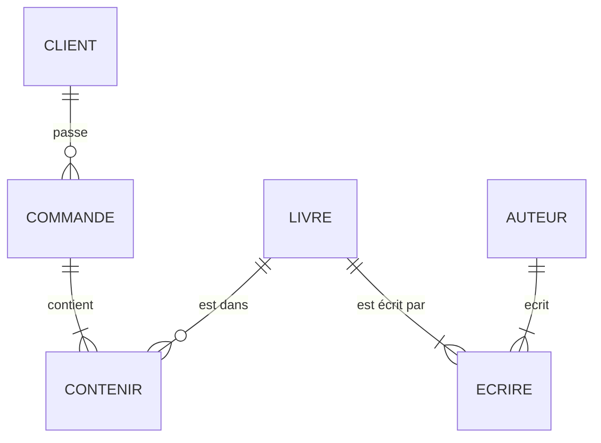

# 📚 Projet : Gestion d'une librairie

Base de données complète pour une librairie : clients, livres, auteurs et commandes.

## Ce que montre ce projet
- Modélisation Merise : MCD → MLD → script SQL
- Associations **1-N** (client → commandes) et **N-N** (livres ↔ auteurs, commandes ↔ livres)
- Clés primaires, clés étrangères, contraintes (`UNIQUE`, `CHECK`, `NOT NULL`)
- Requêtes avec jointures, regroupements et agrégats

## MCD (cardinalités)

| Entité A | Association | Entité B |
|---|---|---|
| CLIENT (0,N) | PASSER | COMMANDE (1,1) |
| COMMANDE (1,N) | CONTENIR *(quantité, prix_unitaire)* | LIVRE (0,N) |
| AUTEUR (0,N) | ÉCRIRE | LIVRE (1,N) |



## MLD (modèle logique)
- **client** (<u>id_client</u>, nom, prenom, email, telephone, ville)
- **auteur** (<u>id_auteur</u>, nom, prenom, nationalite)
- **livre** (<u>id_livre</u>, titre, isbn, prix, stock, annee_publication)
- **commande** (<u>id_commande</u>, date_commande, statut, #id_client)
- **ecrire** (<u>#id_auteur, #id_livre</u>)
- **contenir** (<u>#id_commande, #id_livre</u>, quantite, prix_unitaire)

## Utilisation
```bash
mysql -u root -p < script.sql
```

## Requêtes incluses
1. Livres avec leurs auteurs
2. Montant total de chaque commande
3. Chiffre d'affaires par client
4. Top 3 des livres les plus vendus
5. Livres à réapprovisionner

---
📩 Disponible pour missions de modélisation de bases de données (MCD/MLD, SQL).
